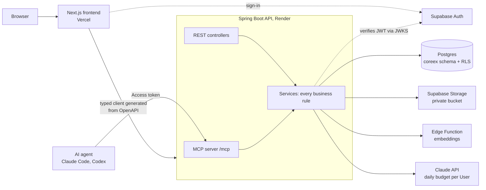

# CoreEx

[](https://github.com/the-KW22/CoreEx/actions/workflows/ci.yml)

A personal knowledge base with a job-search tracker built in. Write Markdown Notes, upload images and PDFs, organise everything with Folders and Tags, connect it with `[[Links]]`, and find it again by words or by meaning. AI agents such as Claude Code can work with it too, through a built-in MCP server.

**Live:** <https://core-ex.vercel.app> (invite-only; for a demo account, contact me through my [GitHub profile](https://github.com/the-KW22)). The API runs on a free Render instance, so the first request after a quiet spell can take up to a minute.

I built CoreEx to learn how production software is made end to end: a typed REST API, a separate frontend, per-user data isolation, migrations, CI, staged releases, and an operated deployment.

## Features

- **Notes** in Markdown with a live-preview editor, autosave and conflict detection when the same Note changes in two places.
- **Assets:** images and PDFs uploaded straight to private storage with short-lived signed links; the API checks the real size and type before accepting them.
- **Folders, Tags, Links and Backlinks.** Links survive renames and moves, and a Graph view shows how everything connects.
- **Search** by words (Postgres full-text search with filters, snippets and a typo-tolerant Ctrl+K switcher) and by meaning (vector embeddings).
- **Trash** with restore, a 30-day purge and storage quotas per User.
- **Career:** track job Applications through stages on a list, board and calendar, write Resumes and Cover Letters that render to PDF, Word and Markdown, and fill an Application's fields from a pasted posting with AI.
- **MCP server and Access tokens:** an AI agent can read, write and organise your knowledge base with a revocable, rate-limited token, and can never delete anything for good.
- **Admin:** invite-only sign-up, Users, quotas and totals. Admins never see anyone else's content.

A full walkthrough is in the [User Guide](docs/USER_GUIDE.md).

## Architecture



The frontend never touches the database: it calls only the REST API, through a client generated from the API's OpenAPI spec. The REST API and the MCP server call the same services, so a rule is written once.

| Layer | Technology |
|---|---|
| Frontend | Next.js 16, React 19, TypeScript, Tailwind CSS 4, shadcn/ui, Motion |
| Backend | Java 21, Spring Boot 4, Spring Security (JWT resource server), Spring AI MCP server, Flyway |
| Data | Postgres on Supabase (row level security on every table, `pg_trgm`, vector embeddings), Supabase Storage and Auth |
| Testing | JUnit with Testcontainers Postgres, Vitest, Playwright |
| Delivery | GitHub Actions, Vercel, Render, semantic-versioned releases |

## Engineering decisions

Hard-to-reverse choices are written down as Architecture Decision Records in [`docs/adr/`](docs/adr/). The ones that shape the most code:

- **Every read and write is scoped to the signed-in User** ([ADR 0001](docs/adr/0001-private-per-user-data-from-day-one.md)). Another User's data answers 404, not 403, so nothing leaks about what exists.
- **Admins can't read User content** ([ADR 0004](docs/adr/0004-admins-cannot-read-user-content.md)). Admin screens show account facts and totals only.
- **Defence in depth in the database** ([ADR 0005](docs/adr/0005-tables-live-in-a-dedicated-schema-with-rls.md)). Tables live in their own schema with row level security on, so Supabase's public API can't reach them even if the app layer had a bug.
- **One API, one contract** ([ADR 0003](docs/adr/0003-nextjs-frontend-spring-boot-api-supabase.md)). CI fails if the committed OpenAPI spec or the generated TypeScript client drifts from the code.
- **Notes are stored as Markdown** ([ADR 0002](docs/adr/0002-markdown-is-the-note-storage-format.md)), so data stays portable and exportable.
- **MCP runs inside the API with hashed Access tokens** ([ADR 0007](docs/adr/0007-mcp-runs-in-process-with-access-tokens.md)) rather than as a separate service with its own copy of the rules.
- **AI costs are bounded** ([ADR 0009](docs/adr/0009-chat-uses-a-hosted-model-on-a-shared-key-with-a-daily-budget.md), [ADR 0013](docs/adr/0013-career-ai-works-only-from-the-users-evidence.md)): a daily budget per User, and Career AI works only from evidence the User wrote.

Domain terms are defined once in [CONTEXT.md](CONTEXT.md), and the UI follows the design system in [docs/DESIGN.md](docs/DESIGN.md).

## How it's tested

- **Backend:** API tests start the real application against a throwaway Postgres in Docker (Testcontainers), covering authorization (another User gets 404), validation and the standard error codes.
- **Frontend:** Vitest unit and component tests, plus Playwright end-to-end tests for the main flows.
- **CI** runs on every pull request: `mvnw verify`, the OpenAPI and generated-client drift checks, typecheck, lint, tests and a production build.

## How it's built

The project runs like a small team's: GitHub Issues with sub-issues and acceptance criteria, one branch and pull request per piece of work, Conventional Commits, squash merges into `staging`, and release pull requests from `staging` to `main` tagged with semantic versions. The full process, including the Definition of Done, is in [docs/DEVELOPMENT.md](docs/DEVELOPMENT.md).

I build with AI coding agents (Claude Code, Codex), and the setup is checked in on purpose: [AGENTS.md](AGENTS.md) gives agents the rules, and [`.agents/skills/`](.agents/skills/) holds the third-party skills they use, pinned by source and hash in [`skills-lock.json`](skills-lock.json). Every change still goes through tests, a review pass and green CI before it merges.

## Repository layout

| Folder | What |
|---|---|
| `backend/` | Spring Boot REST API and MCP server (Java 21, Maven). Owns all business rules and the database. |
| `frontend/` | Next.js UI (TypeScript). Calls only the API, through a client generated from its OpenAPI spec. |
| `supabase/` | Local Supabase config (Postgres, Auth, Storage in Docker) and the embeddings Edge Function. |
| `docs/` | ADRs, the development process, design system, deployment and the User Guide. |

## Prerequisites

JDK 21, Node.js 24, Docker Desktop (running), and the [Supabase CLI](https://supabase.com/docs/guides/cli).

## Run locally

1. **Start local Supabase** (first run downloads images):

   ```bash
   supabase start
   ```

   Stop it with `supabase stop`. Postgres listens on `localhost:54322`. `supabase status` shows the local API URL and keys.

2. **Start the backend** (port 8080). Copy `backend/.env.example` to `backend/.env`, set `OWNER_EMAIL` to the email you will sign up with, load those variables into your shell, then run:

   ```bash
   cd backend
   ./mvnw spring-boot:run
   ```

   Flyway migrates the database on start. Check it: <http://localhost:8080/api/health> and the spec at <http://localhost:8080/v3/api-docs>.

3. **Start the frontend** (port 3000). Copy `frontend/.env.example` to `frontend/.env.local` and put the Publishable key from `supabase status` in `SUPABASE_PUBLISHABLE_KEY`, then:

   ```bash
   cd frontend
   npm install
   npm run dev
   ```

4. **Sign in.** Open <http://localhost:3000>, choose **Create account** with the `OWNER_EMAIL` address, and you land in the app as Admin. Sign-in is email and password only for now. **Forgot password?** on the sign-in page emails a reset link (locally it lands in Mailpit at <http://127.0.0.1:54324>; production setup is in `docs/DEPLOY.md`).

CoreEx's tables live in the `coreex` schema (ADR 0005). If you ran an older version, `public.users` and `public.invites` are unused leftovers; `supabase db reset` clears them.

## Using CoreEx

Inviting people, Notes, Folders, Tags, Links, Assets, Search, Trash, Career, Access tokens and the MCP server are described in the [User Guide](docs/USER_GUIDE.md).

## Deploying

Production (from `main`) is the only cloud environment: a Vercel frontend, a Render backend and one Supabase project. `staging` is the integration branch, checked by CI and by running the stack locally. See [docs/DEPLOY.md](docs/DEPLOY.md) for setup, variables and redeploying.

## API client

The frontend client types are generated from `backend/openapi.json`. After changing the API, run the backend tests (they rewrite the spec), then regenerate the client and commit both:

```bash
cd backend && ./mvnw test
cd ../frontend && npm run generate
```

Never edit `frontend/lib/api/schema.d.ts` by hand.

## Tests

```bash
cd backend
./mvnw test
```

API tests start the real app against a Testcontainers Postgres, so Docker must be running. They do not touch local Supabase.

Frontend checks: `npm run typecheck`, `npm run lint`, `npm run build` (in `frontend/`).

## Configuration

**Hosted Supabase projects (staging, production) must have "Confirm email" turned on** (Authentication > Providers > Email). The API trusts the token's email to recognise the owner and Invites, so without confirmation someone could sign up with an invited address before its owner does. Local Supabase has it off for convenience.

No secrets are committed. Each app has an `.env.example` listing its variables. The local Supabase values in `backend/.env.example` are the fixed, public defaults of `supabase start`.

## License

All rights reserved. The source is public to read and review, not licensed for reuse. See [LICENSE](LICENSE). To report a security problem, see [SECURITY.md](SECURITY.md).
